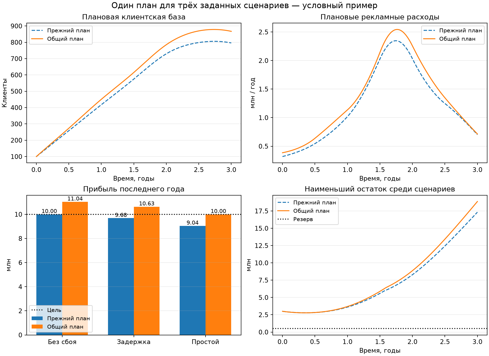

# FunctionSpaceModel-for-Startup

Небольшой исследовательский проект: какие темпы развития подписочного
сервиса нужны, чтобы получить заданную прибыль к заданному сроку
и по дороге не исчерпать денежный резерв?

Мы описываем развитие непрерывными функциями и ищем путь с небольшим
квадратичным штрафом за скорость их изменения. Это вычислительный эксперимент
с условными зависимостями. Он показывает, как поставить и посчитать такую
задачу; точность бизнес-прогноза и практическая полезность ещё не установлены.

## Идея и возможная польза

Начинаем с цели и ищем совместимые с ней пути: как должны меняться
клиентская база, продукт и цена, каких расходов это потребует и хватит ли
денег в каждый момент.

Квадратичный штраф делает быстрые изменения дорогими. Например, если нужно
вырасти с N₀ до N₁ за T лет и других ограничений нет, то
`∫ N′(t)² dt ≥ (N₁ − N₀)² / T`; равенство достигается при постоянном темпе.
Экономические связи и ограничения усложняют этот простой пример.

Такой расчёт может помочь:

- проверить совместимость цели, срока, расходов и обязательного резерва;
- увидеть требуемые темпы привлечения и улучшения продукта;
- сравнить планы с запасом на конкретные сбои и без него;
- понять, какие предположения нужно проверить данными, если вывод
  существенно меняется при их изменении.

Сам по себе большой штраф не означает, что бизнес невозможен. Это выбранная
мера интенсивности развития, а не измеренная вероятность успеха или трудность
работы команды. Необходимые условия для **всех** путей требуют отдельных
математических оценок; особенности одного найденного пути такими условиями
не становятся.

## Что моделируется

Начинаем с готового MVP, команды, клиентской базы и начального капитала.
Новых инвестиций и кредитов нет. Время t измеряется в годах.

| Величина | Смысл |
| --- | --- |
| N(t) | Число платящих клиентов, приближённо непрерывная величина |
| q(t) | Качество: условная доля решённых задач, от 0 до 1 |
| p(t) | Цена подписки как годовой поток с клиента |
| m(t), u(t) | Годовые потоки расходов на рекламу и дополнительное развитие |
| P(t), B(t) | Операционная прибыль в год и остаток денег |

Например, p = 12 000 соответствует цене 1 000 в месяц. Клиентская база,
качество и цена — искомые функции. Выручка, затраты и деньги вычисляются
из них, а не выбираются независимо.

Баланс клиентов и денег:

```text
N′ = a − dN
P  = (p − c)N − m − u − F
B′ = P
```

a — новые клиенты в год, d — интенсивность ухода в год, c — обслуживание
клиента в год, F — обязательные годовые расходы команды и сервиса.
d — интенсивность, а не доля ушедших за произвольный период.
Поступления и выплаты здесь сглажены и совпадают с прибылью;
налоги, задолженность и календарь платежей не моделируются.

Условные зависимости демонстрации:

```text
a = A₀ (1 + αq) √(m / M₀) (p₀ / p)
d = d₀ (1 − βq) (p / p₀)
u = Cq · q′
```

Квадратный корень задаёт убывающую отдачу рекламы. Качество улучшает
привлечение и удержание, повышение цены действует в обратную сторону.
Развитие оплачивается сверх обязательных расходов. Это предположения,
без калибровки по компаниям; метрика q пока не измерялась. При нулевой
рекламе эта модель не даёт органического привлечения. Константы A₀, M₀, p₀,
α, d₀, β и Cq задают масштабы и силу этих эффектов.

Из выбранных N, q, p находим необходимые привлечения `a = N′ + dN`, затем
обращаем рекламную зависимость и получаем m. Отрицательное a запрещено.
Так рост базы связан с расходами и оттоком.

## Задача и способ расчёта

Цель примера — не менее G прибыли **за последний год** к концу третьего
года: `∫[T−1,T] P(t) dt ≥ G`. Это не годовой темп прибыли в конечной точке.
Длина окна задаётся параметром `profit_window`.

Во всё время должны соблюдаться денежный резерв, мощность обслуживания,
диапазон цены, предел рекламы, пределы качества и скоростей изменения
качества и цены. Качество в номинальном плане не убывает.

Среди допустимых путей минимизируем:

```text
J = ∫[0,T] [wN (N′/N*)² + wq (q′/q*)² + wp (p′/p*)²] dt
```

По умолчанию `N* = 1000`, `q* = 1`, `p* = p₀`, веса клиентов и качества — 1,
вес цены — 0; скорость цены ограничена отдельно. Штрафуется скорость
изменения, не ускорение. Значения J сравнимы при одинаковых единицах,
масштабах и весах. `--coordinate relative` заменяет нормированный прирост
клиентов на относительный темп `N′/N` и меняет критерий.

1. Представляем N, q, p непрерывными кубическими сплайнами. Оптимизируем
   их коэффициенты; `--segments` задаёт число участков кривых.
2. Вычисляем производные, расходы, интеграл прибыли и денежный остаток.
3. Решатель SciPy/SLSQP ищет допустимые пути с нескольких начальных
   приближений. Выбираем найденный путь с наименьшим J.
4. Отдельно воспроизводим тот же план адаптивным решателем дифференциальных
   уравнений DOP853. Проверяем цель, резерв, мощность и промежуточные
   нарушения, при необходимости уточняем точки ограничений.

Функции остаются непрерывными; конечное число коэффициентов и численное
интегрирование нужны для расчёта на компьютере. Месячных решений здесь нет.
Независимое воспроизведение даёт численное подтверждение с допусками,
а не формальное доказательство. Глобальный минимум не доказан.
Неудача поиска не доказывает недостижимость цели.

## Запуск и короткий пример кода

Нужны Python 3.11+ и [uv](https://docs.astral.sh/uv/). Из корня репозитория:

```bash
uv sync --python python3
uv run python examples/simple_continuous.py
```

[Короткий пример](examples/simple_continuous.py) использует основной код:
загружает параметры, ищет один общий план для трёх заданных случаев
и печатает штраф, прибыль и минимум денег. Его основной вызов:

```python
config = VariationalConfig.from_file("examples/continuous.json")
events = standard_disturbances(config)
report, rows = optimize_continuous(config, segments=6, disturbances=events)
```

Исходные числа собраны в [examples/continuous.json](examples/continuous.json).
Для сохранения коэффициентов и траекторий:

```bash
# Поиск без сбоев, затем проверка того же плана при сбоях.
uv run fsm variational examples/continuous.json --segments 6 --stress --output-dir artifacts/continuous

# Один план с целью и ограничениями во всех трёх заданных случаях.
uv run fsm variational examples/continuous.json --scenario-plan --segments 6 --output-dir artifacts/common_plan
```

Результаты: `report.json` с параметрами и проверками, `plan.json`
с коэффициентами функций, `trajectory.csv` с траекториями сценариев.
`artifacts/` исключён из Git. Код возврата 0 означает наличие проверенного
кандидата: при `--stress` — только для номинального случая,
при `--scenario-plan` — для всех трёх случаев. При отсутствии кандидата
или ошибке входных данных код возврата — 2.

## Результат условного примера

Цель — 10 млн прибыли за последний год к концу третьего года.
Начальные деньги — 3 млн, обязательный резерв — 0,5 млн, начальная база —
100 клиентов. Валюта условная; это не данные действующего стартапа.

| Случай | Прибыль исходного плана, млн | Прибыль общего плана, млн |
| --- | ---: | ---: |
| Без сбоев | 10,000 | 11,037 |
| Задержка развития на 3 месяца | 9,682 | 10,629 |
| Простой на месяц в середине срока | 9,041 | 10,000 |

Цель выполнена в 1/3 случаев у исходного плана и в 3/3 у общего.
Резерв и мощность соблюдены в 3/3 у обоих. В каждом случае используются
те же заранее выбранные цена, расходы на рекламу и развитие. При задержке
качество приходит позже, расходы остаются по расписанию. Простой
останавливает привлечение, увеличивает уход и требует ремонта;
поступления от оставшихся клиентов продолжаются.

Номинальный J вырос с 0,22814 до 0,27780, на 21,77%. Найденный запас
потребовал за три года около 342 тыс. дополнительных расходов на рекламу
и 24,7 тыс. на развитие. Это сравнение кандидатов, не доказанная минимальная
цена защиты. Отдельная оптимистическая аналитическая нижняя граница J —
0,15922; она не подтверждает оптимальность этих кандидатов.

Защита относится к указанным случаям по отдельности. При их одновременном
наступлении общий план даёт 9,630 млн: резерв сохраняется, цель не достигнута.
Вероятности успеха, гарантий для всех сбоев и проверки прогнозов прибыли
на реальных компаниях здесь нет.



Точные допущения, допуски и результаты — в [отчёте](docs/reports/CONTINUOUS_DEMO.md).
Повторить полное сравнение и проверки:

```bash
uv run --with matplotlib python experiments/scenario_plan_demo.py --plot
uv run python -m unittest discover -s tests -v
```

## Статус и материалы

Текущий небольшой этап завершён: есть постановка, работающий непрерывный
прототип, короткий пример запуска и проверяемый условный расчёт с запасом
на заданные сбои. Это не завершённая модель реального бизнеса. Перед
расширением имеет смысл получить хотя бы один полезный для решения вывод,
который сохраняется при разумном изменении предположений. Дальнейшая
разработка не является обязательным продолжением этого эксперимента.

- [Исходная концепция](docs/CONCEPT.md) — мотивация, требования и решения.
- [Вариационная постановка](docs/VARIATIONAL_MODEL.md) — нормировка, оценки,
  методы, сбои и источники открытых данных.
- [Критический разбор и литература](docs/RESEARCH_NOTES.md) — аналоги,
  ограничения и предложения; новизна метода не установлена.
- [Предложения улучшений](docs/IMPROVEMENT_PLAN.md) — исследовательский резерв,
  а не обязательный план.
- [Первый непрерывный эксперимент](experiments/variational_demo.py) —
  аналитические проверки, сравнение весов и координат.
- [Сравнение удержания по опубликованным когортам](docs/reports/RETENTION_COMPARISON.md) —
  отдельный эксперимент, который не валидирует прибыль или оптимизатор.

Ранний месячный прототип сохранён для воспроизведения:
[модель и запуск](docs/MONTHLY_MODEL.md#11-реализованный-базовый-прототип),
[результаты](docs/reports/BASELINE_DEMO.md). Он решает другую задачу на конечной
сетке цен и бюджетов; его границы не относятся ко всем непрерывным путям.

Основной непрерывный код: [variational.py](src/function_space_model/variational.py),
[сплайны](src/function_space_model/curves.py),
[общий план сценариев](src/function_space_model/scenarios.py),
[командный интерфейс](src/function_space_model/cli.py).
Контекст для работы с репозиторием — [AGENTS.md](AGENTS.md).
