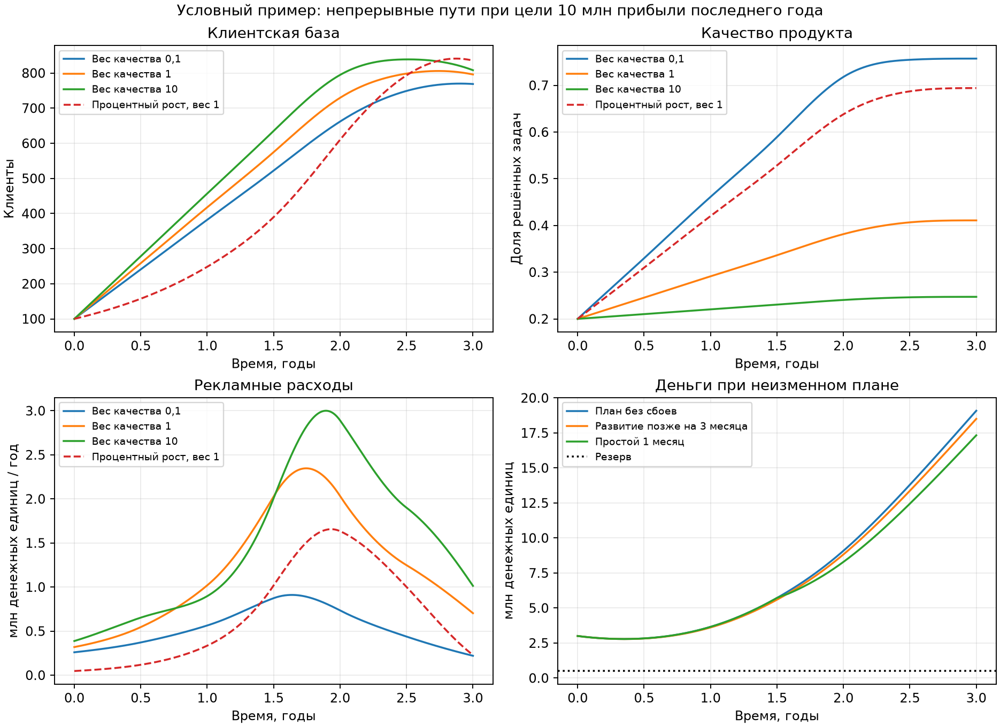
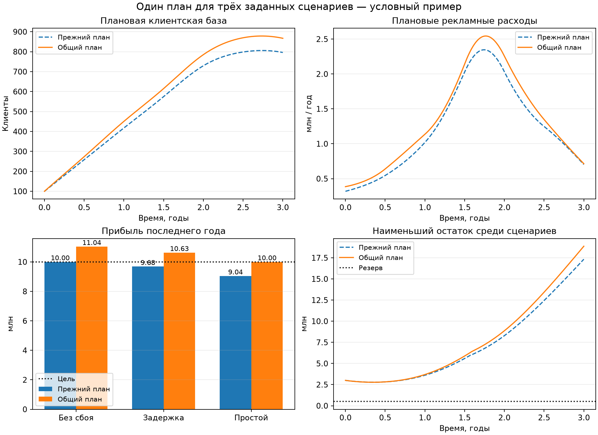

# Непрерывная вариационная модель: исходный и общий план

Дата: 2026-11-09. Все параметры бизнеса условные, без калибровки по компаниям.

Дополнено 2026-11-10: найден один общий план, выполняющий цель и резерв
в трёх заданных сценариях. Значение того же номинального штрафа выше
на 21,77%. См. [новый расчёт](#общий-план-для-трёх-сценариев).
Ниже сначала сохранены результаты исходного этапа от 9 ноября.

## Исходный результат от 9 ноября

Реализован поиск непрерывных путей клиентов, качества и цены с квадратичным
штрафом. Выручка, расходы и денежный остаток вычисляются из этих путей.
Для связанного примера найдены численно проверенные кандидаты в 6/6
вариантов. Глобальная оптимальность не доказана.

Базовый пример: цель 10 млн прибыли за последний год к концу третьего
года; стартовые деньги 3 млн, резерв 0,5 млн. Найденный путь даёт около
10 млн прибыли, минимальный остаток 2,786 млн. При неизменных плановых
решениях задержка развития на три месяца уменьшает прибыль до 9,682 млн,
простой на месяц — до 9,041 млн. Оба сбоя сохраняют резерв, но нарушают
цель прибыли. Это стресс-проверка номинального плана, не устойчивый оптимум.



## Принятые для этого эксперимента допущения

Запрос автора разрешает перейти от исследования к первому расчёту.
Ниже выбраны конкретные демонстрационные связи, чтобы задача стала
вычислимой. Они не считаются установленными закономерностями рынка
или окончательными требованиями к общей модели.

Время t — годы. N — агрегированная непрерывная база платящих клиентов;
q — условная доля успешно решённых задач по фиксированному набору, 0–1.
Данные измерения q пока отсутствуют. Цена p — годовой денежный поток
с клиента: 12 000 в год соответствует 1 000 в месяц. Все расходы ниже
также заданы потоками за год, если не указано иное.

| Параметр | Значение |
| --- | ---: |
| Горизонт / окно целевой прибыли | 3 года / последний год |
| Целевая операционная прибыль до налогов | 10 000 000 |
| Начальная база / мощность | 100 / 5 000 клиентов |
| Начальное качество / максимум / максимальный темп | 0,2 / 1 / 0,5 в год |
| Начальная цена / диапазон | 12 000 / 6 000–18 000 в год |
| Максимальная скорость изменения цены | 6 000 за год изменения годовой цены |
| Начальные деньги / резерв | 3 000 000 / 500 000 |
| Обязательные расходы команды и сервиса | 1 920 000 в год |
| Обслуживание клиента | 1 200 в год |
| Максимальный поток рекламных расходов | 3 000 000 в год |
| Дополнительные затраты на единицу прироста качества | 600 000 |

MVP уже существует; расходы на его создание не восстанавливаются.
Новых инвестиций и кредитов нет. Денежные поступления и выплаты усреднены
во времени и совпадают с признанием выручки/расходов. Это упрощение
не проверяет реальный календарь помесячных оплат и предоплаты подрядчикам.

## Связи внутри примера

Предложенная возрастающая вогнутая реакция на рекламу m:

\[
a=600(1+q)\sqrt{m/1\,200\,000}\;12\,000/p.
\]

Интенсивность ухода и дополнительные расходы на развитие:

\[
d=0{,}6(1-0{,}7q)\;p/12\,000,\qquad u=600\,000\dot q.
\]

Обязательные балансы:

\[
\dot N=a-dN,\qquad
\Pi=(p-1\,200)N-m-u-1\,920\,000,\qquad \dot B=\Pi.
\]

Уход d — годовая интенсивность, не доля клиентов за календарный год.
Привлечение a неотрицательно, качество не убывает, ограничены цена,
темп качества и цены, реклама, мощность и денежный резерв.
Улучшение качества оплачивается дополнительно к обязательной команде.

Для заданных путей N,q,p получаем a=Ṅ+dN и обращаем рекламную функцию,
вычисляя необходимый m. Таким образом клиентский баланс выполняется
по построению; возможность оплатить нужное привлечение проверяется
ограничениями. Отрицательное a запрещено, а не превращается в бесплатное
привлечение при возведении формулы в квадрат.

Базовый критерий при времени в годах:

\[
J=\int_0^3[(\dot N/1\,000)^2+w_q\dot q^2]dt.
\]

Цена участвует в экономике и ограничена по уровню и скорости; её вес
в штрафе в этом эксперименте равен нулю. В коде он настраивается.
Для отдельного сравнения относительного роста используется (Ṅ/N)²
вместо (Ṅ/1 000)². Эти два критерия имеют разный смысл; значения J
между ними нельзя ранжировать как «лучше» и «хуже».

## Способ расчёта и независимая проверка

Пути представлены кубическими B-сплайнами с простыми внутренними узлами:
это непрерывные функции с непрерывными первыми и вторыми производными.
Начальные значения фиксированы. Количество участков задаёт гибкость
приближения, а не календарный шаг бизнеса. Производные и интеграл
квадратичного штрафа вычисляются из базиса.

Для ограничений используются квадратуры Гаусса и дополнительные точки.
Коэффициенты сплайнов ограничивают уровни клиентов, цены и качества;
коэффициенты производных задают достаточные ограничения скоростей
качества и цены. Эти условия сужают рассматриваемое семейство.
Численный поиск — SLSQP с тремя детерминированными начальными приближениями.

После поиска независимо решаются клиентское и денежное дифференциальные
уравнения методом DOP853 с исходными плановыми рекламой, ценой и расходами
на развитие. Контрольные экстремумы рекламы уточняются между точками.
При нарушении добавляются точки проверки и поиск повторяется; аналогично
может уточняться проверка денежного остатка. Сбои и граница последнего
года разбивают интегрирование на отдельные интервалы, чтобы короткое
событие не было пропущено адаптивным шагом.

Это независимая численная проверка, не интервальный сертификат выполнения
каждого ограничения во все моменты времени. Допуск денег — 0,05 денежной
единицы, согласования клиентской базы при воспроизведении — 0,01 клиента.
Найденные максимумы скоростей также численные. Неудача поиска имеет статус
`no_verified_candidate` и не называется доказательством невозможности.

Использованы [BSpline](https://docs.scipy.org/doc/scipy/reference/generated/scipy.interpolate.BSpline.html),
[SLSQP](https://docs.scipy.org/doc/scipy/reference/optimize.minimize-slsqp.html)
и [solve_ivp](https://docs.scipy.org/doc/scipy/reference/generated/scipy.integrate.solve_ivp.html)
из SciPy. Версии расчёта: NumPy 2.5.4, SciPy 1.18.1.

## Аналитические проверки и нижняя граница

Проверены 12 случаев: 2 координаты клиентов × 3 размера базиса ×
2 длительности чистой паузы. Во всех 12/12 численный результат совпал
с известным минимумом; максимальная абсолютная ошибка J — 1,56×10⁻¹⁵.
Для заданных концов линейной координаты минимум равен Δx²/T;
для логарифмической — ln(N*/N₀)²/T. Пауза заменяет T на T−D.

Для связанного бизнеса получена отдельная оптимистическая нижняя граница.
Из неотрицательности рекламы и развития, p≤p_max следует:

\[
\overline N_{\text{последний год}}\ge
(G/W+F_0)/(p_{\max}-c)=709{,}524,
\]

где W=1 год. Представив интеграл N через N₀ и Ṅ и применив
неравенство Коши — Буняковского, получаем

\[
J\ge\frac{w_N}{T-2W/3}
\left[\frac{\max(\overline N_{\min}-N_0,0)}{s_N}\right]^2
=0{,}159222546.
\]

В выводе используются наиболее благоприятная допустимая цена,
неотрицательность расходов и фактическая цель за последний год.
Расходы на привлечение и развитие оптимистически отброшены; их добавление
не понижает нижнюю границу. Формула относится к любому допустимому пути
этой постановки, не только к сплайнам. При относительном критерии
используется более слабая граница ln(max(N̄_min/N₀,1))²/T.

Значение базового кандидата 0,228137417 выше абсолютной границы
на 0,068914870. Этот зазор не устранён; кандидат не объявляется
глобальным минимумом общего пространства функций.

## Уточнение представления

Здесь во всех строках одинаковый критерий и вес качества 1.

| Участки сплайна | Свободные коэффициенты | Штраф J |
| --- | ---: | ---: |
| 1 | 9 | 0,231616660 |
| 3 | 15 | 0,229086816 |
| 6 | 24 | 0,228137417 |

Переход с 3 на 6 участков снизил найденный штраф на 0,4144%.
Это проверка чувствительности к представлению, а не доказательство
сходимости к глобальному минимуму. В этих трёх случаях различаются
и формы рекламы: один интегральный показатель не описывает весь путь.

## Зависимость от веса качества

Абсолютный штраф клиентов, 6 участков, одинаковые бизнес-условия:

| Вес качества | Клиенты в конце | Качество в конце | Реклама за 3 года, млн | Развитие за 3 года, млн | Минимум денег, млн |
| --- | ---: | ---: | ---: | ---: | ---: |
| 0,1 | 768,743 | 0,7572 | 1,6218 | 0,3343 | 2,7551 |
| 1 | 795,918 | 0,4108 | 3,7266 | 0,1265 | 2,7857 |
| 10 | 808,044 | 0,2472 | 4,5813 | 0,0283 | 2,7908 |

Во всех 3/3 случаях достигается целевая прибыль в пределах допуска.
Большой штраф качества заставляет меньше улучшать продукт и больше
тратить на рекламу при заданном в примере положительном эффекте качества.
Это следствие критерия и гипотез отклика, не эмпирический вывод о компаниях.
Сравнивать величины J при разных весах как единый рейтинг нельзя.

При относительном штрафе с весом качества 1 конечная база — 835,356,
качество — 0,6941, реклама — 2,1491 млн, развитие — 0,2965 млн.
Максимальный абсолютный прирост — около 473 клиентов в год против 336
у базового абсолютного критерия. Штраф за процентный темп допускает
более быстрый абсолютный рост на большой базе.

В базовом случае J_N=0,210216963, J_q=0,017920454, цена не штрафуется.
Начальные 100 клиентов превращаются в 795,918; максимум базы до конца
периода — около 805,803. После T не задано условие продолжения роста,
поэтому часть путей в конце снижает базу. Это ограничение смысла цели.

## Стресс-проверка одного фиксированного плана

Цена, рекламный бюджет и расходы на разработку берутся из базового
плана с весом качества 1 и не переоптимизируются после события.

| Случай | Прибыль последнего года, млн | Недобор цели, млн | Минимум денег, млн | Цель / резерв |
| --- | ---: | ---: | ---: | --- |
| Без сбоев | 10,0000 | ≈0 | 2,7857 | Да / да |
| Развитие позже на 3 месяца | 9,6817 | 0,3183 | 2,7829 | Нет / да |
| Простой сервиса на 1 месяц | 9,0412 | 0,9588 | 2,7857 | Нет / да |

Для задержки q_факт(t)=q_план(max(0,t−0,25)), а расходы на развитие
остаются в первоначальном календаре. Для простоя в середине горизонта
новое привлечение прекращается на 1/12 года, интенсивность ухода
увеличивается на 1 в год и возникает дополнительный расход 100 000.
Платежи действующих подписчиков продолжаются с учётом изменившейся базы;
автоматическое обнуление выручки за время простоя не вводилось.

В обоих случаях общие расходы на рекламу и развитие сохраняются:
3,7266 и 0,1265 млн. Проверка подтверждает сохранение плановых решений,
а не знание будущего сбоя при выборе действий. Цель выполнена в 0/2
стресс-случаев, резерв сохранён в 2/2. Вероятности событий не задаются.
Оптимизация номинальной цели приводит к почти активному ограничению
прибыли; запас по цели не создавался. Устойчивое планирование остаётся
следующим отдельным расширением.

## Найденные проблемы и проверки

Первый расчёт с весом качества 10 удовлетворял ограничениям только
в исходных точках: плотная проверка обнаружила рекламный пик около
3 000 172 при лимите 3 000 000. Все три стартовых решения этого случая
были отклонены, и временный результат составлял 5/6 проверенных вариантов.
Это было нарушение ограничения между точками, не недостижимость цели.

После добавления точек около непрерывно уточняемого пика и повторного
поиска максимальный бюджет равен 3 000 000,0014 — в пределах допуска 0,05.
Первому старту потребовались три уточнения; последующие используют уже
расширенный набор точек. Итог: 6/6 вариантов и 18/18 стартов дали
численно проверенных кандидатов. Для этой ошибки добавлен регрессионный тест.

Также при поиске экстремумов отфильтрован шум округления на постоянных
участках: машинные колебания не должны порождать сотни ложных пиков.
Ограничение рекламы при этом не ослаблялось, бюджеты не обрезаются
после расчёта для искусственного сохранения клиентской траектории.

Полный набор: **45/45 тестов**, из них **14/14 новых**, время полного
запуска 7,351 с. До добавления регрессионного случая проходили 13/13 новых
тестов; после его добавления отдельно прошли 14/14. Проверены аналитические
минимумы, нормировка, денежный баланс с известным решением, прибыль именно
за целевое окно, сериализация путей, короткий сбой и сохранение расходов
при задержке. Прежние 31 тест месячной модели и эксперимента удержания
также проходят. Точность прогнозов реального бизнеса не измерялась:
данных для такого сравнения в этом эксперименте нет.

## Воспроизведение и файлы

```bash
uv run fsm variational examples/continuous.json --segments 6 --stress --output-dir artifacts/continuous
uv run --with matplotlib python experiments/variational_demo.py --plot
uv run python -m unittest discover -s tests -v
```

- [Полная конфигурация примера](../../examples/continuous.json).
- [Скрипт сравнения](../../experiments/variational_demo.py).
- [Полные результаты, коэффициенты путей и статусы всех стартов](assets/variational/experiment.json).
- [Траектории шести вариантов и двух сбоев](assets/variational/paths.csv).
- [График PNG](assets/variational/continuous_paths.png) и [SVG](assets/variational/continuous_paths.svg).

CLI сохраняет report.json, plan.json и trajectory.csv; путь можно
воспроизвести через ContinuousPlan.from_file и replay. Без проверенного
кандидата старый plan.json удаляется, код возврата — 2. Успешный код 0
означает наличие номинального кандидата: результаты стресс-проверок
нужно смотреть отдельно. Они могут не достигать цели, как в этом примере.

## Общий план для трёх сценариев

Дата дополнения: 2026-11-10. По запросу продолжить реализована оптимизация
одного плана цены, рекламы и расходов на развитие для следующих условий:

1. Нет сбоев.
2. Влияние развития продукта задерживается на 0,25 года; расходы идут
   по исходному календарю.
3. Простой длится 1/12 года и начинается в t=1,5 года. Привлечение
   прекращается на этот период, интенсивность ухода увеличивается
   на 1 в год, восстановление требует 100 000.

Решения общие, а клиентская база и деньги рассчитываются отдельно
для каждого случая. Номинальный путь N,q,p по-прежнему задаёт плановые
рекламные расходы через исходный отклик. При сбоях бюджет не вычисляется
заново под фактическую базу и план не подстраивается под заранее известный
исход. Поиск выбирает один план с учётом всего перечисленного набора.

### Критерий и область защиты

Сохранён **прежний номинальный функционал** J с весами клиентов и качества 1.
Добавлены обязательные ограничения цели, резерва и мощности в каждом
сценарии. Это позволяет непосредственно сравнивать J двух планов.
Минимакс штрафа по фактическим траекториям сценариев в этом варианте
не используется. Значение J не является денежным расходом или вероятностью.

Набор содержит ровно три фиксированных условия. Их вероятности,
произвольное время начала и длительность простоя, случайные ошибки
отклика и все сочетания событий не покрываются этим расчётом.
Найденные кандидаты проверены численно, глобальный минимум и строгий
сертификат ограничений на всём непрерывном интервале не получены.

### Численный метод

Номинальные балансы считаются как раньше. В сценариях при фиксированных
плановых решениях клиентский баланс линеен по фактической базе:

\[
\dot N_s=a_s(t)-d_s(t)N_s,\qquad
N_s(t)=e^{-H_s(t)}\left[N_0+\int_0^t e^{H_s(v)}a_s(v)\,dv\right],
\quad H_s(t)=\int_0^t d_s(v)\,dv.
\]

Для поиска эта формула вычисляется квадратурами Гаусса. Матрица частичных
интегралов позволяет получить состояния внутри каждого интервала,
не запуская отдельный адаптивный интегратор для каждой пробы коэффициентов.
Границы интервалов включают узлы сплайна, сдвинутые узлы качества,
начало и конец простоя и границу целевого года. Производные штрафа
и общие решения остаются такими же, как в исходном расчёте.

При проверке независимо используется прежний DOP853. Новая формула
проверена на полиномах и известном решении линейного баланса с ненулевым
уходом, затем сопоставлена с DOP853 для задержки и короткого простоя
в абсолютной и относительной координатах клиентов.

### Прибыль и резерв

| Условие | Прежний план: прибыль, млн | Общий план: прибыль, млн | Общий план: минимум денег, млн |
| --- | ---: | ---: | ---: |
| Без сбоев | 10,0000 | 11,0366 | 2,7814 |
| Задержка развития на 3 месяца | 9,6817 | 10,6292 | 2,7781 |
| Простой на 1 месяц | 9,0412 | 10,0000 | 2,7814 |

Прежний план достигает цели в **1/3** случаев, общий — в **3/3**.
Резерв и мощность соблюдены в **3/3** для обоих планов. Ограничение цели
в сценарии простоя почти активно; запас по остальным сценариям возникает
при поиске общего плана. Значения, очень близкие к 10 млн, трактуются
с прежним денежным допуском 0,05.

### Цена найденного запаса

| Показатель | Прежний план | Общий план | Разница |
| --- | ---: | ---: | ---: |
| Номинальный штраф J | 0,228137417 | 0,277802862 | +21,7700% |
| Вклад клиентов в J | 0,210216963 | 0,252302968 | +0,042086005 |
| Вклад качества в J | 0,017920454 | 0,025499894 | +0,007579440 |
| Плановая реклама за 3 года, млн | 3,726648 | 4,069039 | +0,342391 |
| Дополнительное развитие за 3 года, млн | 0,126502 | 0,151167 | +0,024665 |
| Требуемые начальные деньги для этого фиксированного плана по всем трём случаям | 717 080,91 | 721 881,83 | +4 800,92 |
| Клиенты в конце номинального пути | 795,918 | 867,084 | +71,166 |
| Качество в конце номинального пути | 0,410836 | 0,451945 | +0,041108 |

Начальный капитал в обоих поисках оставался равен 3 млн. Строка
«требуемые начальные деньги» получена по минимальному денежному остатку
уже найденного фиксированного плана; это не глобальный минимум капитала.
При заданных 3 млн дополнительного финансирования не требуется.
Рост суммарных расходов не равен росту стартовой потребности: изменение
сроков расходов и поступлений позволяет покрывать часть затрат выручкой.

Надбавка 21,77% относится к найденным кандидатам при одинаковом критерии.
Она не доказывает минимальную неизбежную стоимость защиты во всём
пространстве функций. Прежняя аналитическая нижняя граница 0,159222546
остаётся верной, поскольку номинальная цель входит и в новую задачу,
но она пока слишком слаба для вывода об оптимальности общего плана.

### Уточнение и независимая проверка

| Участки общего плана | Свободные коэффициенты | Номинальный J | Цель и резерв |
| --- | ---: | ---: | --- |
| 1 | 9 | 0,282029508 | 3/3 |
| 3 | 15 | 0,279597751 | 3/3 |
| 6 | 24 | 0,277802862 | 3/3 |

В каждом размере использовано три начальных приближения: проверенные
кандидаты получены из **9/9** стартов общего плана. Для прежнего плана
при повторном расчёте также успешны **3/3** старта. Учитывая номинальный
сравнительный запуск, кандидаты найдены в **4/4** расчётных вариантов.
Это число запусков, не статистическая оценка вероятности успеха бизнеса.

На выбранном общем плане расхождение быстрого расчёта с DOP853 меньше
10⁻⁶ клиента и 10⁻⁶ денежной единицы для каждого из двух сбоев.
Во всех трёх размерах максимальная ошибка целевой прибыли — около
2,1×10⁻⁶, значительно меньше допуска 0,05.
Общие расходы на рекламу и развитие совпадают между сценариями
с точностью интегрирования, что отдельно проверяется тестом.

### Дополнительный случай за пределами условий поиска

После выбора общего плана отдельно проверено одновременное наступление
той же задержки и того же простоя. Оно **не входило в ограничения**.
Прибыль — 9,629610 млн, недобор — 0,370390 млн, минимальные деньги —
2,778118 млн. Цель выполнена в **0/1** дополнительном случае,
резерв и мощность сохранены в **1/1**.

Это показывает конкретную границу защиты: выполнение каждого из двух
сбоев по отдельности не обеспечивает их сочетание. Если нужна защита
от сочетания, его следует включить в условия поиска, а при неизвестном
времени события — отдельно определить соответствующее множество случаев.
Результат 3/3 относится только к исходному набору и не смешивается
с этой дополнительной проверкой.

### Тесты и воспроизведение дополнения

Полный набор — **53/53 теста**, из них **8/8 новых**; полный запуск занял
24,062 с при параллельном выполнении эксперимента. Ранее отдельно прошли
8/8 новых тестов за 4,364 с. После расширения сравнения координат повторно
прошли 8/8 новых тестов за 6,184 с.
Прежние аналитические проверки и тесты непрерывной и месячной моделей
сохраняются в полном наборе.

Проверены общий план, идентичность плановых расходов, начальные и конечные
условия событий, обе координаты клиентов, короткий сбой, CLI и запрет
принимать успех номинального расчёта при провале независимой проверки
сценария. Вероятность успеха и точность прогнозов реальных компаний
не оценивались: пример остаётся условным.

```bash
uv run fsm variational examples/continuous.json --scenario-plan --segments 6 --output-dir artifacts/common_plan
uv run --with matplotlib python experiments/scenario_plan_demo.py --plot
uv run python -m unittest discover -s tests -v
```

В режиме `--scenario-plan` код 0 и сохранение plan.json означают наличие
кандидата, прошедшего независимые проверки во всех трёх заданных случаях.
Траектории каждого случая сохраняются в одном trajectory.csv;
в report.json отдельно записаны область критерия, список событий,
ошибки воспроизведения и результаты проверок. Неудача поиска не объявляется
недостижимостью цели. Пользовательские конечные наборы Disturbance
можно передавать через аргумент disturbances Python-функции.



- [Скрипт дополнения](../../experiments/scenario_plan_demo.py).
- [Результаты, параметры и коэффициенты всех планов](assets/common_plan/experiment.json).
- [Траектории двух планов в трёх сценариях](assets/common_plan/paths.csv).
- [График PNG](assets/common_plan/common_plan.png) и [SVG](assets/common_plan/common_plan.svg).
