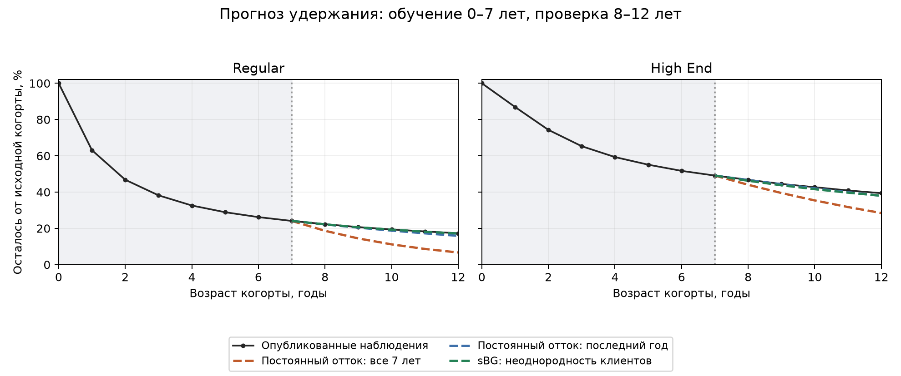

# Сравнение прогнозов удержания с опубликованным примером

Дата: 2026-11-09. Это проверка одного механизма, не оценка качества всей
модели бизнеса и не данные нашего стартапа.

## Данные и источник

Взяты числовые данные таблицы 1 на странице 78 статьи
[Fader, Hardie (2007), How to Project Customer Retention](https://faculty.wharton.upenn.edu/wp-content/uploads/2012/04/Fader_hardie_jim_07.pdf).
В ней два сегмента неопределённого подписочного бизнеса; источник
ссылается на Berry и Linoff (2004). Таблица проверена визуально по PDF.
Период — **год**, а не месяц; опубликованы округлённые проценты, не история
платежей отдельных пользователей. Размеры когорт не предполагаются известными.

Сохранены [CSV фактов](../../experiments/data/fader_hardie_2007.csv)
и [происхождение и ограничения данных](../../experiments/data/retention_source.json).
Полный текст статьи в репозиторий не копируется.

## Протокол

Параметры оценивались только по годам 0–7. Прогнозируются годы 8–12,
по пять точек в каждой из двух когорт. Все методы получают одно и то же
наблюдаемое состояние на конец года 7 и прогнозируют оставшуюся от исходной
когорты долю. Группы рассматриваются отдельно.

1. **Constant MLE:** постоянный риск ухода, оценённый по всей обучающей
   истории с учётом цензурирования: d = (1-S(7))/sum_{t=0}^6 S(t).
   Такая геометрическая динамика соответствует ядру нашего кода при
   фиксированной цене и нулевом привлечении. Само это оценивание добавлено
   только в исследовательском скрипте; основной прототип пока не обучается.
2. **Latest:** постоянный будущий риск, равный последнему наблюдавшемуся:
   d = 1-S(7)/S(6). Это сильная простая альтернатива, использующая более
   актуальный состав базы.
3. **sBG:** beta-геометрическое смешение индивидуальных рисков. Два
   параметра оцениваются по сгруппированной цензурированной likelihood;
   использованы шесть начальных точек, положительные параметры и проверка
   сходимости. Размер исходной когорты является общим множителем
   likelihood и не нужен для этих точечных оценок.

Все прогнозы условны на S_obs(7):

\[
\widehat S(t)=S_{obs}(7)\frac{S_{model}(t)}{S_{model}(7)}.
\]

Для постоянного ухода отношение равно (1-d)^(t-7). Это честное общее
начальное состояние для сравнения с нашим симулятором. Протокол отличается
от безусловной экстраполяции кривой от года 0 в графиках исходной статьи;
полученные здесь ошибки нельзя выдавать за авторские результаты статьи.

Параметры оценены до расчёта ошибок удержания на годах 8–12. Отложенные
значения не используются ни в функции оценивания, ни для выбора начальной
точки по ошибке прогноза. Это проверяется тестом: изменение только holdout
не меняет параметры и предсказания.

## Результаты

MAE — средняя абсолютная ошибка в **процентных пунктах** доли исходной
когорты. Общее среднее использует 10 точек: 2 когорты × 5 лет, с одинаковым
весом каждой точки. Эти точки зависимы во времени и не являются десятью
независимыми бизнес-экспериментами.

| Метод | MAE Regular, 5 точек | MAE High End, 5 точек | MAE всего, 10 точек | RMSE всего, 10 точек |
| --- | ---: | ---: | ---: | ---: |
| Постоянный отток MLE | 7,6791 | 7,0394 | 7,3592 | 7,8464 |
| Постоянный отток последнего года | 0,7118 | 0,6894 | 0,7006 | 0,8492 |
| sBG | 0,1286 | 1,0126 | 0,5706 | 0,7571 |

Прогноз на год 12:

| Когорта | Наблюдение, % | Constant MLE, % | Latest, % | sBG, % |
| --- | ---: | ---: | ---: | ---: |
| Regular | 17,30 | 6,6934 | 15,8707 | 17,1443 |
| High End | 39,40 | 28,4608 | 37,9347 | 37,9618 |

Относительная ошибка на год 12, знаменатель — наблюдаемая доля
соответствующей исходной когорты:

| Когорта | Constant MLE | Latest | sBG |
| --- | ---: | ---: | ---: |
| Regular, наблюдение 17,3% | −61,3100% | −8,2619% | −0,8998% |
| High End, наблюдение 39,4% | −27,7646% | −3,7191% | −3,6503% |

Параметры, все знаковые ошибки, значения каждого года и версии пакетов:
[JSON результатов](assets/literature/retention_comparison.json),
[CSV прогнозов](assets/literature/retention_predictions.csv).



[Векторный рисунок SVG](assets/literature/retention_comparison.svg).

## Разбор

Постоянный риск, оценённый по всей истории, здесь сильно занижает
остаточную базу. Он переносит высокий ранний риск ухода на уже отобранных
давних клиентов. Это конкретное ограничение нашей постоянной возрастной
динамики, если использовать такой способ калибровки.

Однако обновить постоянный риск по последнему году уже достаточно,
чтобы резко улучшить результат. sBG имеет меньший общий MAE, но уступает
Latest в High End по среднему пяти прогнозных лет: 1,0126 против 0,6894 п.п.
На конечном году 12 их ошибки почти одинаковы. В Regular sBG заметно лучше.
Следовательно, на этом примере нельзя утверждать, что усложнение всегда
лучше обновляемой простой модели. Выигрыш sBG по общему MAE относительно
Latest составляет около 0,1300 п.п.; его устойчивость на других данных
не установлена.

Низкий риск ухода старых клиентов не доказывает рост репутации: его уже
может объяснить неоднородность клиентов. Добавлять скрытую репутацию до
проверки такого простого механизма означало бы рисковать двойным учётом
одного эффекта.

## Ограничения сравнения

- Две когорты одного опубликованного примера. Это выбранная авторами
  иллюстрация модели, а не случайная представительная выборка сервисов.
- Данные округлены до 0,1 п.п.; размеры выборок неизвестны. Стандартные
  ошибки, значимость различий и доверительные интервалы не заявляются.
- Разделение обучения и проверки соблюдено вычислительно, но сам пример
  и подход sBG уже опубликованы вместе. Это не независимое подтверждение
  превосходства sBG на ранее неизвестном наборе бизнесов.
- Годовые коэффициенты не переносятся на месячную модель. Здесь нет
  изменений цены и рекламы, затрат, денежных потоков и инцидентов.
- Кривые — прогнозы среднего выживания когорты в соответствующих моделях.
  Это не диапазоны надёжности нашего оптимизатора.
- Ошибки прогнозов прибыли и необходимого капитала, вероятности нарушения
  резерва, покрытие интервалов и экономический выигрыш от политики
  **не получены**, потому что этих данных и полного эксперимента здесь нет.

## Воспроизведение и проверки

```bash
uv run python experiments/retention_forecasts.py
uv run --with matplotlib python experiments/retention_forecasts.py --plot
uv run python -m unittest discover -s tests -v
```

Основные расчёты используют зависимости проекта; matplotlib нужен только
для рисунка. Основная модель и оптимизатор в этой задаче не менялись.
31 автоматический тест прошёл: 27 прежних и 4 проверки исследования
(аналитический постоянный риск, известное beta-смешение, восстановление
параметров из цензурированных данных, отсутствие утечки holdout).
